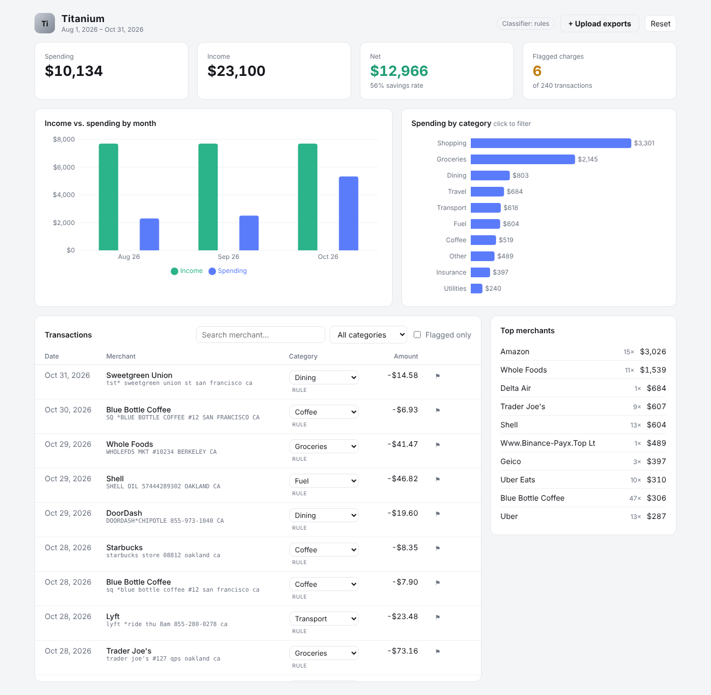

# Titanium — AI Financial Data Platform

Turn messy bank exports into a clean spending dashboard. Upload CSV/Excel files from any bank;
Titanium normalizes them with a Pandas pipeline, classifies every transaction (LLM with a rule-based
fallback), flags unusual charges, and shows it all in a React dashboard.



**Stack:** Python · FastAPI · PostgreSQL · SQLAlchemy · Pandas · React · TypeScript · Vite · Recharts · Claude / OpenAI-compatible LLMs · Docker

## Features

**Pandas cleaning pipeline** (`backend/app/pipeline.py`)
- Auto-detects the header row, skipping the summary/preamble lines banks put on top (e.g. Bank of America)
- Maps different column schemas (`Posting Date` / `Transaction Date`, `Amount` vs. split `Debit`/`Credit`, `Type` columns)
- Parses mixed date formats (`09/01/2026`, `09/01/26`, `2026-09-01`, `01-Sep-2026`, …)
- Parses amounts like `$1,234.56`, `($45.00)`, `45.00 CR`, `-12.50`
- Normalizes merchants: `SQ *BLUE BOTTLE COFFEE #12 SAN FRANCISCO CA` → `Blue Bottle Coffee`, `AMZN Mktp US*2K4L19RT2` → `Amazon`, `WHOLEFDS MKT #10234` → `Whole Foods`
- Drops balance/total rows and blanks; content fingerprints dedupe overlapping statements and re-uploads while keeping legitimate same-day repeats

**LLM classification** (`backend/app/classifier.py`)
- Unique *new* merchants are batched to the LLM, which returns strict JSON with a category from a fixed list, plus a `suspicious` flag and a reason
- Results are cached per merchant, so each merchant goes to the LLM only once
- When you change a category in the UI, the change applies to every transaction from that merchant and is reused on future uploads
- With no API key it falls back to a keyword rule engine, so the app works fully offline

**Unusual-charge detection**
- Charges ≥3× your usual amount at a merchant
- Statistical outliers within a category (median + 4σ)
- Large first-time charges and big charges at unrecognized merchants
- Possible double charges (same merchant + amount within 3 days)
- Crypto/high-risk merchants, bank fees, and LLM-flagged merchants

**Dashboard**: KPIs (spending, income, net and savings rate, flagged count), monthly income vs. spending, category breakdown (click a bar to filter), top merchants, and a searchable transaction table with inline recategorization and flag dismissal.

## Quick start

### Docker (Postgres)
```bash
cp .env.example .env          # optionally add ANTHROPIC_API_KEY or OPENAI_API_KEY
docker compose up --build
```
Open http://localhost:3000 and drop in the files from `sample_data/`. API docs: http://localhost:8000/docs

### Local dev (SQLite, no Docker)
```bash
# backend
cd backend
python -m venv .venv && source .venv/bin/activate
pip install -r requirements.txt
uvicorn app.main:app --reload            # uses sqlite:///./titanium.db unless DATABASE_URL is set

# frontend (new terminal)
cd frontend
npm install
npm run dev                              # http://localhost:5173, proxies /api to :8000
```

To use LLM classification, set `ANTHROPIC_API_KEY` (default model `claude-haiku-5-5`), or `OPENAI_API_KEY`
(plus optional `OPENAI_BASE_URL` for any OpenAI-compatible provider). Override the model with `LLM_MODEL`.

### Tests
```bash
cd backend && pytest -q
```
28 tests cover amount/date/merchant parsing, all three sample bank formats, dedupe, anomaly rules,
the LLM path (mocked), and an end-to-end API flow.

## API

| Method | Path | Description |
|---|---|---|
| `POST` | `/api/upload` | Multipart upload of one or more CSV/XLSX files |
| `GET` | `/api/transactions` | Filters: `start`, `end`, `category`, `flagged`, `q`, `limit`, `offset` |
| `PATCH` | `/api/transactions/{id}` | `{category}` (applies to the merchant) or `{is_flagged}` |
| `GET` | `/api/summary` | Totals, by month, by category, top merchants |
| `GET` | `/api/categories` | Allowed categories |
| `GET` | `/api/uploads` | Upload history |
| `DELETE` | `/api/transactions` | Reset all data |

## Project structure
```
backend/
  app/main.py         FastAPI routes
  app/pipeline.py     Pandas normalization pipeline
  app/classifier.py   LLM + rules classification, anomaly detection
  app/db.py           SQLAlchemy models (Postgres / SQLite)
  tests/
frontend/
  src/App.tsx         Dashboard layout
  src/components/     UploadZone, Charts, TransactionsTable
  src/api.ts          Typed API client
sample_data/          Messy Chase, Bank of America and Capital One style exports (synthetic)
```
